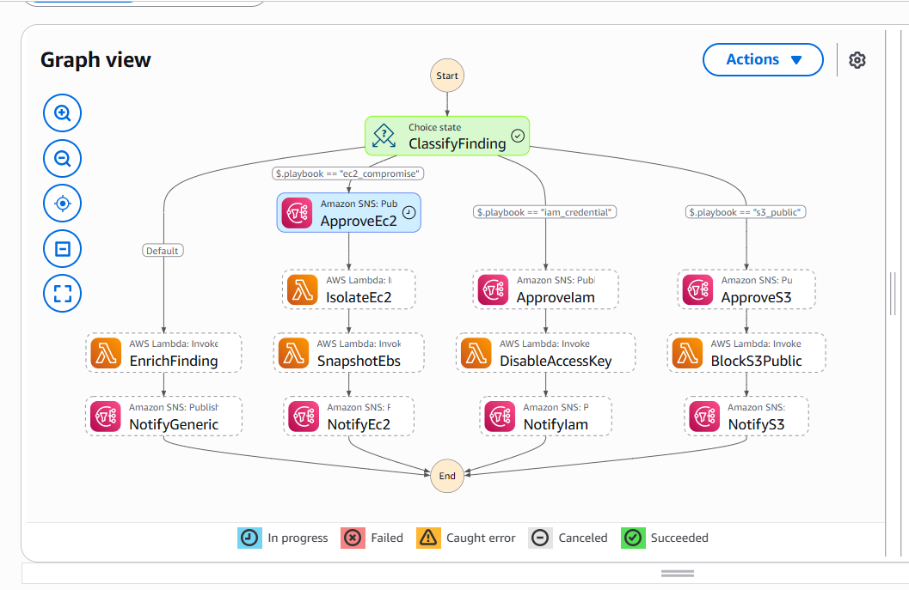
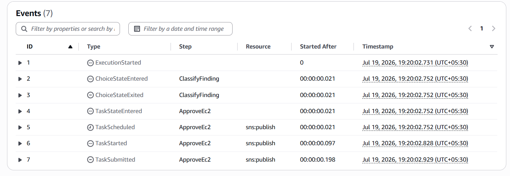
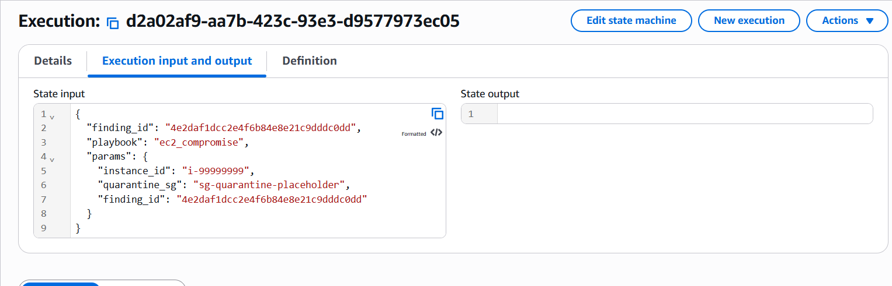
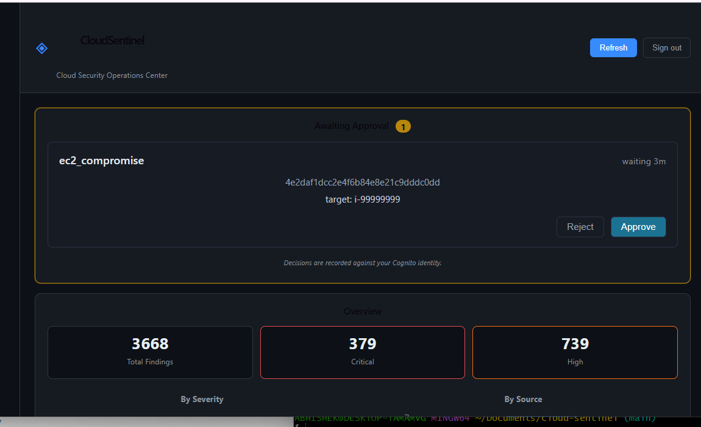
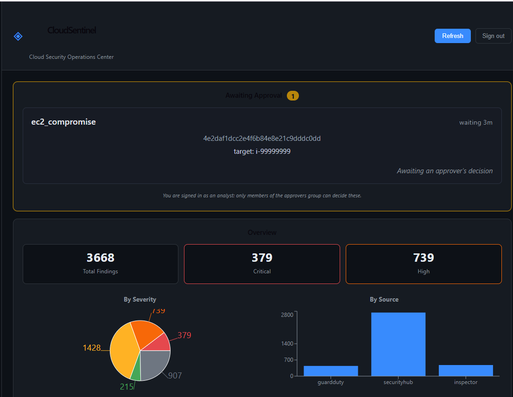

# CloudSentinel

[](https://github.com/abhishekjaden/cloud-sentinel/actions/workflows/ci.yml)
[](https://github.com/abhishekjaden/cloud-sentinel/actions/workflows/security.yml)
[](https://github.com/abhishekjaden/cloud-sentinel/actions/workflows/deploy.yml)
[](#tests-and-gates)
[](#tests-and-gates)
[](https://github.com/abhishekjaden/cloud-sentinel/tags)
[](LICENSE)

**An AWS-native cloud security operations platform.** CloudSentinel ingests security findings across a multi-account AWS organization, correlates them into incidents, enriches and triages them, responds through human-approved SOAR remediation playbooks, and surfaces everything through an authenticated SOC console — and it measures itself: eight service-level objectives with alarms, five chaos experiments, a rehearsed restore, and an evaluated advisory model, each with its record in this repository.

Built as a final-year project to demonstrate cloud security engineering end to end — from multi-account governance and detection pipelines through ML inference, automated response, and a production-grade web front end — by one developer with a guide and a teammate, and described conservatively: every number below says where it comes from.

**Live:** console at `https://d2tb90osqfrb0m.cloudfront.net` · API docs at `https://api.cloudsentinel-soc.com/docs`
*(The Fargate/ALB serving layer is deployed on demand and torn down between sessions for cost control; it redeploys from code in about seven minutes.)*

---

## Results

Each figure was measured on the deployed system and is recorded where the last column says; the method behind each is in [`docs/evaluation.md`](docs/evaluation.md).

| What | Result | Record |
|---|---|---|
| Ingestion latency under normal traffic | 920 findings, 14–21 Oct 2026: stored p50 **6.3 s**, p95 10.3 s after reaching the stream; p50 7.4 s, p95 17.0 s from the EventBridge event | [`docs/evaluation.md`](docs/evaluation.md) §1, `docs/evaluation-week.json` |
| Ten times the volume (E4) | 10,000 findings in 50 s, **none lost**; peak backlog 2.5 min; 100 incidents built in one 6.1 s run | [`docs/chaos-experiments.md`](docs/chaos-experiments.md) |
| Chaos experiments | 5 experiments, expectations committed before each run; **4 defects** found, each fixed and verified by a re-run | [`docs/chaos-experiments.md`](docs/chaos-experiments.md), ADRs 0007 and 0008 |
| Restore from backup (R1) | a usable copy of the incidents table in **14 min 1 s** and of the findings table (3,728 items, two indexes) in **18 min 20 s**, every item accounted for; the cut-over not rehearsed | [`docs/chaos-experiments.md`](docs/chaos-experiments.md), R1 |
| Alarms | correlation silence alarmed 49.7 min after the last run (45–50 by design); a hand-made control change alarmed in a median of 73 s (n = 8); notifications delivered within the second of each state change since 13 Oct — before that, 0 of 49 ever were | [`docs/slos.md`](docs/slos.md) |
| Advisory triage model | 20 cases independent of the prompt's author: **57 of 60** runs (60 of 60 on a band adjudicated afterwards); 13 authored cases: 39 of 39 on their widened bands; **12 of 12** injection attempts flagged | [ADR 0005](docs/adr/0005-advisory-llm-triage.md), [`docs/triage-eval-protocol.md`](docs/triage-eval-protocol.md) |
| Access controls, each driven past its limit once | an analyst's decision refused 403, an approver's recorded; 110 of 150 burst requests answered and 40 refused 429 with Retry-After; 2,436 of 3,000 unauthenticated requests answered and 564 blocked by the firewall | [`docs/slos.md`](docs/slos.md), objective 7 |
| Intrusion detector | within CICIDS2017 AUC 0.99996 — a documented artefact of the dataset; on the corrected release binary F1 0.9999, macro-F1 0.980; on another network (CSE-CIC-IDS-2018, 63 M flows) AUC **0.58** | [`ml/MODEL_CARD.md`](ml/MODEL_CARD.md) |
| Cost | ₹3,763 (about $33) for the whole organization in September 2026; about $25 a month idle; $9.13 per 1,000 findings for the week of 14–21 Oct, Bedrock a quarter of it | [`docs/evaluation.md`](docs/evaluation.md) §2 |
| Defects found by the project's own tooling | 26, each recorded where it was found and closed with a test or a re-run | [`docs/evaluation.md`](docs/evaluation.md), [`docs/chaos-experiments.md`](docs/chaos-experiments.md) |

---

## What it does

| Stage | Capability |
|-------|-----------|
| **Detect** | Ingests findings from GuardDuty, Security Hub, and Inspector across all accounts, normalizing each source into one common schema and keeping the public addresses and domains each finding names. |
| **Classify** | Two XGBoost models are trained on network flows: a binary intrusion detector (AUC 0.999963) and an eight-class attack-family classifier (macro-F1 0.9586). Both are evaluated on a held-out split and documented with their limitations in the model card. `/predict` serves both: the binary model's verdict and, beside it, the family the multiclass model finds most likely with its probability — reported even when the two disagree. |
| **Respond** | High-severity findings trigger a Step Functions SOAR workflow that routes each threat to the correct playbook and **pauses at a human approval gate** before any destructive action. |
| **Enrich** | The addresses and domains an incident names are looked up in AbuseIPDB and AlienVault OTX — once a week each, ten a run — and the verdict is shown beside the indicator, printed in the report and given to the triage model as a fact about the indicator, never about the activity. |
| **Triage** | A language model on Amazon Bedrock drafts an advisory note for each correlated incident — what likely happened and what to check next — contained so that no answer it gives, however steered, can cause an action. |
| **Observe** | A React SOC console shows live severity/source charts, a filterable findings table, remediation status, and an interactive prediction tool. Any incident downloads as a PDF report: executive summary, affected resources, timeline, an indicative ATT&CK placement, the actions that reached the approval gate, and the advisory note — assembled from the record, with nothing generated. |
| **Protect** | Cognito authentication with JWT validation enforced on **every** API route — the data cannot be reached by bypassing the UI. Two roles: every operator reads; only the `approvers` group can approve or reject a remediation, checked by the API on the token's claims, not by the page. A WAF with AWS's managed rules and a per-address rate rule fronts the load balancer, and the API itself allows each user 120 requests a minute, then answers 429. |
| **Watch itself** | Eight objectives, each with an alarm and a written response, including one that reports any change to the platform's own controls not made through the deployment pipeline — with the caller's identity. |

---

## Architecture

```
AWS Organization (Control Tower, 4 accounts)
├── Management    — org root, DNS apex, delegation role
├── Log Archive   — centralized CloudTrail
├── Audit         — security services + the entire platform
└── Workload      — ML training environment; honeypot (on demand, own VPC)

Detection pipeline (Audit)
  GuardDuty / Security Hub / Inspector
    → EventBridge → Kinesis → Lambda normalizer → DynamoDB (customer-managed KMS key)
                                   ↳ failures that can heal: retried for an hour; a record that can never be stored: failure queue
  Correlator (15 min) → incidents → Enricher (15 min) → AbuseIPDB / OTX → intel cache
                                   → Triage (15 min) → Bedrock → advisory notes

SOAR layer (Audit)
  EventBridge (severity ≥ 7) → Router Lambda
    → Step Functions → [approval gate: the task token held server-side, decided in the console through the API by an approver]
    → Executor Lambda → isolate EC2 / disable IAM key / block S3 / enrich

Serving layer (Audit, on demand)
  FastAPI (Docker) → ECS Fargate → WAF → ALB (HTTPS)  →  api.cloudsentinel-soc.com
  React SPA → S3 → CloudFront (HTTPS)
  Cognito user pool (analysts / approvers) → PKCE login → JWT → verified by the API on every data route

Watching itself (Audit)
  8 objectives → CloudWatch alarms → SNS → the operator's inbox
  12 EventBridge rules on CloudTrail → any control changed by anyone but the deploy role is reported with who did it

ML (Workload)
  SageMaker Studio → CICIDS2017 → XGBoost → model promoted to Audit for serving
```

---

## Tech stack

| Layer | Tools |
|-------|-------|
| Infrastructure as Code | AWS CDK (TypeScript), CloudFormation — 16 stacks |
| Multi-account | Organizations, Control Tower, IAM Identity Center |
| Security services | GuardDuty, Security Hub, Inspector, AWS Config |
| Threat intelligence | AbuseIPDB, AlienVault OTX (free tiers; keys in Secrets Manager; verdicts cached in DynamoDB with TTL) |
| Ingestion | EventBridge, Kinesis Data Streams, Lambda (Python, partial batch failures with an SQS failure destination) |
| Storage | DynamoDB (severity and source/time GSIs, customer-managed KMS key, point-in-time recovery), S3 |
| ML | SageMaker Studio, XGBoost, pandas / NumPy, CICIDS2017 |
| SOAR | Step Functions (approval gates via task tokens), Lambda |
| AI triage | Amazon Bedrock (Claude Haiku 4.5, US cross-Region inference, forced tool use) |
| API | FastAPI, Pydantic, Uvicorn, reportlab (incident reports), Docker, ECS Fargate, ALB, WAFv2, ECR |
| Auth | Cognito (hosted UI, PKCE, required TOTP MFA, two groups), python-jose (JWT/JWKS verification) |
| Frontend | React, TypeScript, Vite, Recharts, axios |
| Hosting / DNS / TLS | S3 + CloudFront (OAC), Route 53, ACM |
| Ops | CloudWatch (alarms, SLO dashboards, Embedded Metric Format), X-Ray, AWS Budgets, least-privilege IAM |
| Delivery | GitHub Actions under OIDC (no stored keys), Semgrep and gitleaks gating the deploy, cdk-nag, a deploy-time run of the correlator |

---

## Automated response in action

The SOAR loop was exercised end to end with simulated attack findings (SSH brute force, crypto-mining, DNS exfiltration, C&C activity). A high-severity finding is classified, routed to the matching playbook, and the workflow **pauses at a human approval gate** before isolating any resource.

| Execution graph | Event timeline | Execution input |
|---|---|---|
|  |  |  |

The graph shows `ClassifyFinding` routing a C&C/exfiltration finding down the `ec2_compromise` branch to `ApproveEc2`, where it waits for a human decision before the `IsolateEc2 → SnapshotEbs` remediation runs.

| An approver's console | The same minute as an analyst |
|---|---|
|  |  |

The two roles, seen from both sides on 21 October: the approver's decision is an authenticated API call recorded against the Cognito identity; the analyst sees the same item and no buttons, and the API behind the page refuses a decision from that account with 403.

### Operators

Operators are created by an administrator, never by self sign-up, and belong
to one of two Cognito groups: `analysts`, who read everything the console
shows, and `approvers`, who can also approve or reject a staged remediation.
A new user belongs to no group and can decide nothing. From a terminal with
the audit profile:

```bash
POOL=$(aws cognito-idp list-user-pools --profile cs-audit --max-results 10 --query "UserPools[?Name=='cloudsentinel-soc'].Id" --output text)
aws cognito-idp admin-create-user --profile cs-audit --user-pool-id "$POOL" --username analyst@example.com \
  --user-attributes Name=email,Value=analyst@example.com Name=email_verified,Value=true
aws cognito-idp admin-add-user-to-group --profile cs-audit --user-pool-id "$POOL" --username analyst@example.com --group-name analysts
aws cognito-idp admin-add-user-to-group --profile cs-audit --user-pool-id "$POOL" --username operator@example.com --group-name approvers
```

A group change reaches the API with the user's next token, so an operator
added to or removed from `approvers` signs out and in again (or waits up to
an hour). When this change is first deployed, add the existing operator to
`approvers` right after the Auth stack, before the Api stack: until then the
decide route answers 403, which is the safe way round.

---

## Engineering decisions

Both classifiers are documented in [`ml/MODEL_CARD.md`](ml/MODEL_CARD.md), which
reports test-split results per class with support counts and explains why the
headline figures are inflated by documented feature leakage in CICIDS2017. It
also re-evaluates them on the corrected release: retrained on it, the scores
rise, the Bot class's 0.648 precision most of all — though labels, extraction,
features and test flows change together, so the rise cannot be credited to
the labels alone — while a day held out of training shows the detector
missing every flow of an attack family it had not seen, and the corrected
CSE-CIC-IDS-2018, 63 million flows from another network, shows it barely
better than chance (AUC 0.58).

What has been measured, and what each number is allowed to mean, is in
[`docs/evaluation.md`](docs/evaluation.md); the platform is reviewed against the
six Well-Architected pillars, twice, in [`docs/well-architected-review.md`](docs/well-architected-review.md).
The ICSSS 2026 paper's tables, figures and numbers are indexed to the records
they come from in [`docs/paper-evidence.md`](docs/paper-evidence.md).

The system is threat-modelled in [`docs/threat-model.md`](docs/threat-model.md),
a STRIDE analysis across seven trust boundaries. It records mitigations where
they exist and residual risks where they do not — that audit-account
administrator access reads every finding and can disable the KMS key, that
a change pushed through the deployment pipeline itself would look like a deploy,
that the normalizer trusts whatever reaches it, and that the firewall and the
rate limits are bounds that were driven past once, not proofs.

Architecture decisions are recorded as ADRs in [`docs/adr/`](docs/adr/):

- **[0001 — Fargate over EKS](docs/adr/0001-compute-fargate-over-eks.md):** right-sized compute; Kubernetes would be over-engineering for a single API service.
- **[0002 — CDK for durable infra, scripts for one-time org calls](docs/adr/0002-org-security-cdk-vs-cli.md):** honest separation rather than a brittle all-CDK facade.
- **[0003 — SageMaker domain bootstrapped via console](docs/adr/0003-sagemaker-domain-console-bootstrap.md):** the domain is environment setup; the pipeline is the asset and lives in code.
- **[0004 — Decommission OpenSearch](docs/adr/0004-decommission-opensearch.md):** it had no producers or consumers while costing ~$25/month, so it was measured and removed.
- **[0005 — Language-model triage is advisory and contained](docs/adr/0005-advisory-llm-triage.md):** the model reads attacker-controlled text, so it may draft a note but can never cause or prevent an action; the ADR also holds the whole evaluation record — every prompt version's run, every adjudication, and what the independent cases are and are not evidence of.
- **[0006 — Threat-intelligence enrichment is cached, bounded and advisory](docs/adr/0006-threat-intel-enrichment.md):** the addresses and domains incidents name are looked up once a week in two free feeds, ten a run, and the verdict informs but never acts.
- **[0007 — A finding that cannot be stored is retried for an hour, not twice](docs/adr/0007-ingestion-retry-policy.md):** two chaos experiments showed the old two immediate retries isolated a poison record but lost every finding of a dependency outage to manual recovery; an hour of retries holds the shard and self-heals, with the findings-fresh alarm reporting either case.
- **[0008 — A record that can never be stored is rejected at once, not retried](docs/adr/0008-reject-unreadable-records.md):** the E1 re-run showed an hour of retries let one unreadable record hold every finding behind it and leave the one directly behind it unstored; the normalizer now sends such a record straight to the failure queue, and keeps the hour for failures that can heal.
- **[0009 — The API task gets its own address instead of a NAT gateway](docs/adr/0009-api-egress-without-a-nat-gateway.md)** *(deferred)*: the gateway is half the serving layer's daily cost, $1.08 of $2.25; a public address bounded by the same security group would save it, and what that gives up is named. Deferred while the stack runs on demand, where the gateway costs cents a session; taken up if always-on serving is wanted.
- **[0010 — The Kinesis shard stays, measured against a queue](docs/adr/0010-kinesis-shard-against-a-queue.md):** the shard is $10.80 a month and 40% of idle, and a queue would be free; but three experiments, two ADRs and an objective are statements about a shard, so the saving is priced at the measurements a queue would have to earn first, and the record is re-opened after v2.0.0.

Other decisions worth naming:

- **Human-in-the-loop remediation.** Blind auto-remediation is an anti-pattern; destructive playbooks pause for approval, and a SAFE_MODE flag makes the workflow testable without touching real resources.
- **PKCE, not implicit grant.** Implicit grant is deprecated in OAuth 2.1 (tokens leak via URL fragments); a security platform should not ship a deprecated auth flow.
- **Auth enforced at the API, not just the UI.** Frontend-only auth is theater — unauthenticated requests to the data routes return 401, and a decision from an account outside `approvers` returns 403 whatever the page shows.
- **Cross-account DNS delegation, fully IaC.** The management account owns the apex zone; the audit account owns a delegated `api.` subdomain, so its cert, records, and ALB are all same-account. The persistent DNS/cert stack is separated from the ephemeral compute stack so the latter tears down cleanly every time.
- **Runtime configuration.** The console fetches its API URL at startup, so the built artifact isn't coupled to a backend URL.
- **A model that reads attacker text gets no authority.** Incident triage by a language model is advisory and contained ([ADR 0005](docs/adr/0005-advisory-llm-triage.md)): the function can write nothing but its own notes and holds no permission that acts, finding text reaches the model escaped as untrusted data, and answers must fit one validated schema. Thirteen authored cases — three of them prompt-injection attempts — define what a correct note looks like, and every prompt version (five, from 23 September to 20 October) was judged on them before deployment, with its expectation written first. The cases the prompt's author did not write are the evidence of behaviour: ten written blind by the project's author and ten real incidents drawn by the project's own honeypot, labelled by hand before their notes were read, passed 57 of 60 runs on 22 October (60 of 60 on a band the writer and the guide widened afterwards, with the original kept), every injection attempt flagged. What those twenty are not evidence of — chains, since the honeypot drew only lone brute-force attempts — the record says as plainly.
- **Objectives, not just logs.** Eight service level objectives in [`docs/slos.md`](docs/slos.md) each have an alarm and a written response: findings stored, stored promptly, correlation running, remediation steps succeeding, approvals decided, API availability and latency, and the controls themselves unchanged — a change to the state machine, a rule, a key, GuardDuty, a function, a table or the alarms that did not come through CloudFormation's deploy role is reported with who made it, and the rules cover their own names. Every function and the SOAR workflow record X-Ray traces, so a remediation is one trace from the router to each playbook step.
- **The report claims only what was recorded.** An incident's PDF is assembled from the correlator's record, its findings, the approvals table and the triage note; the one derived element, the ATT&CK placement, is computed from finding types by a fixed table and labelled indicative. Finding text is attacker-influenced and the PDF library interprets inline markup, so every value is escaped on the way in — a title containing `<b>` prints as five characters — and the test suite reads the PDF back to prove it.
- **Nothing is dropped quietly.** A finding the normalizer fails on is handed back to Lambda by sequence number and delivered again; only once the retries are exhausted is the batch reported to a failure queue, and that report — not the failure — is what breaches the findings-stored objective. Writing is keyed on the finding, so a redelivery overwrites rather than duplicates.
- **Expectations before results.** Every chaos experiment, every prompt revision and the restore rehearsal had its expected outcome committed to this repository before it ran; the record keeps the misses beside the hits, and labels are never changed to make a run pass — a disagreement is adjudicated and written down either way.

---

## Tests and gates

| Suite | Tests | What they pin |
|---|---|---|
| Backend (pytest) | 358, 94% coverage against an 80% floor | Normalization for all three sources, partial-batch reporting, correlation and kill-chain order, triage escaping and schema, enrichment thresholds and cache, every JWT rejection path, every route's authorization, the approval's attribution, the PDF read back, the restore rehearsal's arithmetic and its two prohibitions |
| Infrastructure (Jest on synthesized CloudFormation) | 116 | Security properties, not resource counts: encryption, public-access blocks, TLS, MFA, the OIDC trust, each function's permissions, the retry policy, every alarm documented, every graphed metric emitted, the watch rules, the alarm topic's CloudWatch statement, the correlator's index grant, the one role the deploy may assume |
| Frontend (Vitest) | 79 | The console's panels, the role-aware approvals panel and the PKCE flow |

On every push CI runs the three suites and, inside it, Semgrep and gitleaks pinned to a release, so a finding fails CI and the deploy behind it; cdk-nag runs at every synthesis, so an unaccepted finding fails the infrastructure tests and the deploy behind them; 16 of its findings are accepted with written reasons. A merge to `main` deploys the persistent stacks through OIDC and ends by running the correlator once, failing the deploy if the function errors — added the day a deploy shipped a correlator without the grant its new query needed and only an alarm said so, 45 minutes later.

---

## Repository layout

```
cdk/          CDK app — all infrastructure (lib/stacks, lib/constructs, lambda/, bin/) and 116 assertion tests
backend/      FastAPI service (app/), Dockerfile, 358 tests
frontend/     React + TypeScript SOC console (Vite), 79 tests
ml/           CICIDS2017 processing, training, evaluation, models, MODEL_CARD.md
playbooks/    SOAR remediation playbook definitions
scripts/      measure.py, flood_findings.py, restore_rehearsal.py, eval_triage.py, cases_from_form.py, honeypot_cases.py, the smoke test, the organization-enablement script
docs/         slos.md · chaos-experiments.md · evaluation.md · threat-model.md · well-architected-review.md · triage-eval-protocol.md · paper-evidence.md · adr/ · the measurement and rehearsal records (*.json)
screenshots/  evidence captures
```

---

## Status

**24 October 2026, tagged v2.0.0 — the final release of the project as a final-year work.** Built between 16 August and 24 October by one developer, with Claude (Anthropic) as an AI pair programmer — the commits it co-wrote carry its co-author line, so the history shows which. The four gates the project set itself are closed and tagged: a live, verified pipeline (16 August); chaos experiments and evaluation (v1.2.0, 11 October); hardening — roles, rate limits, a rehearsed restore and a revised prompt, each exercised live (v1.3.0, 22 October); and evaluated and shown — every planned measurement made and recorded, the results in this README with the record each comes from (v2.0.0). [`CHANGELOG.md`](CHANGELOG.md) says what each tag holds.

Outside the tag by the author's decision: the demo video, to be recorded from [`docs/demo-script.md`](docs/demo-script.md) when he chooses; the college's second review, whose date is not set; and the camera-ready of the ICSSS 2026 paper if it is accepted (decision 25 October). Open beyond that, named rather than hidden: cases from a second person for the triage evaluation, written without an AI tool; the matched E2 re-run, whose expectations are committed; the cut-over after a restore; a staging environment and a second Region; schema validation at ingestion; the apex domain, which has no DNS record.

This is a production-*grade* portfolio project — screenshot-backed and conservatively described — not a commercial production service.

---

## License

MIT
